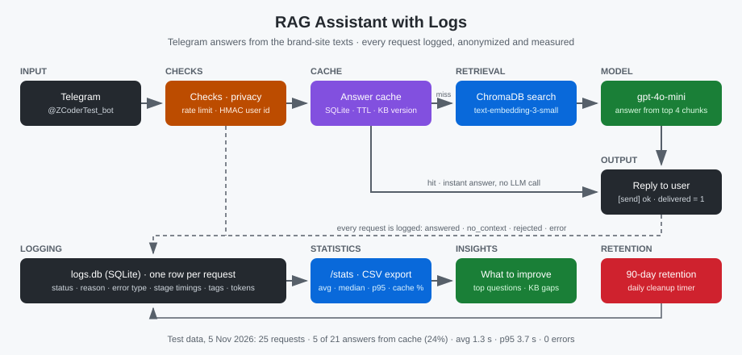

🇷🇺 [Русский](../ru/11-rag-assistant-logs.md) · 🇬🇧 [English](../en/11-rag-assistant-logs.md) · 🇪🇸 [Español](../es/11-rag-assistant-logs.md)

# Case Study: RAG Assistant with Logs

**Showcase:** [rag-assistant-logs](https://github.com/alexanderomobile/rag-assistant-logs/blob/main/README.md)
**Status:** ✅ Production

---

## Problem

Telegram assistant for service questions that logs every request and keeps statistics.

## Features

The @ZCoderTest_bot bot answers questions about Alexander's services from his brand-site texts (RAG: ChromaDB, OpenAI text-embedding-3-small embeddings, gpt-4o-mini), with an SQLite answer cache. Every request is logged to SQLite: status, reason, error type, stage timings, tags. Anonymized user id (HMAC), contacts redacted from text, 90-day retention timer, /stats. Runs as a systemd service on a home Proxmox server.

## Business value

Shows what prospects ask, what is missing in the materials and how fast answers arrive; repeated questions are answered instantly from cache. Test data of 5 Nov 2026: median response 1.2 s, 7 of 26 answers from cache, 0 errors.

## Results

Test data of 5 Nov 2026 (no live clients yet): 31 requests, 21 demo and 10 in Telegram; 26 answered from the knowledge base, 7 of them from cache (27%); median response 1.2 s, average 1.4 s; 4 questions with no answer in the knowledge base (2 off-topic, 1 undescribed service, 1 callback request) went to the “what to add” list; 1 question was rejected as too long; 0 errors. The logs exposed a 60.8 s API connection hang (fixed with a 5 s connect timeout and retry; a later hang cost 10.5 s) and an answer taken from the wrong case (the cases in the knowledge base were restructured).

## Stack

See showcase README.

## Modules

RAG · Answer cache · Request log · Statistics · Anonymization · 90-day retention

## Screenshots

## Run

See showcase README for run instructions.

---

[← Back to portfolio](https://github.com/alexanderomobile/portfolio/blob/main/README.en.md)
