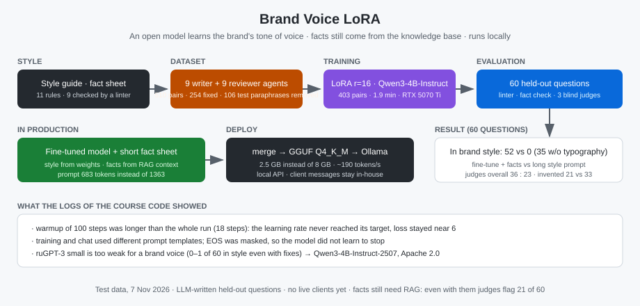

🇷🇺 [Русский](../ru/12-brand-voice-lora.md) · 🇬🇧 [English](../en/12-brand-voice-lora.md) · 🇪🇸 [Español](../es/12-brand-voice-lora.md)

# Case Study: Brand Voice LoRA

**Showcase:** [brand-voice-lora](https://github.com/alexanderomobile/brand-voice-lora/blob/main/README.md)
**Status:** 🧪 Runs on an owned server, no live clients yet

---

## Problem

An open model answers in the brand's tone of voice: LoRA fine-tuning and local deployment.

## Features

Qwen3-4B-Instruct-2507 is LoRA-fine-tuned to answer in the voice of Alexander's assistant (AI automation for real-estate agencies): short, polite, no hype or markup, ending with a next step. The 403-pair dataset was written and reviewed by Claude agents from a style guide and a fact sheet; paraphrases of held-out questions were found with embeddings and removed. Evaluation on 60 held-out questions: style linter, automatic number and contact check, blind LLM judges. The model is converted to GGUF Q4_K_M and served by Ollama on an owned server.

## Business value

The model itself keeps the brand style instead of a long prompt: the request is half as long and client messages stay in-house. Test data of 7 Nov 2026: 52 of 60 answers in style vs 0 for the long-prompt model; facts still come from the knowledge base.

## Results

Test data of 7 Nov 2026 (no live clients yet), 60 held-out questions, paraphrases found in training were removed. With a short fact sheet the fine-tuned model answers in the brand style in 52 of 60 cases (variants of the same model range from 47 to 56), while the base model with a long style prompt and the same facts scores 0 (35 if typography is ignored); the prompt is 683 tokens instead of 1363. Blind judges (3 Claude agents per pair, each with its own answer order): style 59 : 1 and overall 36 : 23 for the fine-tune, helpfulness on par (25 : 28). Even with the fact sheet the judges flagged an invented claim in 21 of 60 answers (33 for the prompt); without it the model invents brand details, so facts must come from the knowledge base (RAG). Training took 1.9 min on an RTX 5070 Ti; in Ollama the Q4_K_M model is 2.5 GB and runs at about 190 tokens/s. An independent review found test questions leaking into the first version's training data; the leak was removed and the model retrained.

## Stack

See showcase README.

## Modules

Style guide · Agent-written dataset · Leak audit · LoRA · Blind judges · Ollama

## Screenshots

## Run

See showcase README for run instructions.

---

[← Back to portfolio](https://github.com/alexanderomobile/portfolio/blob/main/README.en.md)
