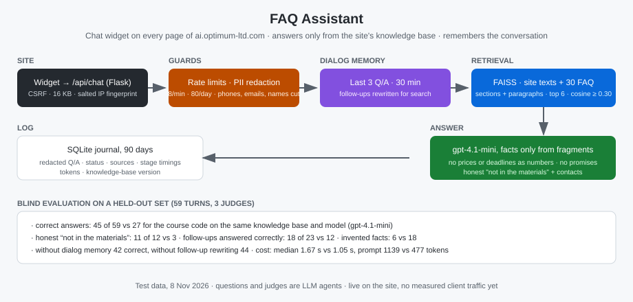

🇷🇺 [Русский](../ru/13-faq-assistant.md) · 🇬🇧 [English](../en/13-faq-assistant.md) · 🇪🇸 [Español](../es/13-faq-assistant.md)

# Case Study: FAQ Assistant

**Showcase:** [faq-assistant](https://github.com/alexanderomobile/faq-assistant/blob/main/README.md)
**Status:** 🧪 Live on ai.optimum-ltd.com, evaluated on test questions

---

## Problem

Website chat assistant: answers from the knowledge base, remembers the conversation and understands follow-ups.

## Features

A widget in the bottom-right corner of every page of ai.optimum-ltd.com calls the site's own /api/chat (Flask, CSRF, body size limit); the site forwards the question to a FastAPI assistant that listens on 127.0.0.1 only. FAISS search over the site texts and 30 FAQ entries: sections and their paragraphs, text-embedding-3-large, top 6 fragments, a similarity threshold. Memory of the last three question/answer pairs; a follow-up such as “and the second one?” is rewritten into a standalone question before search. gpt-4.1-mini answers only from the retrieved fragments, with no prices or promises. Visitor contacts are removed before OpenAI, an anonymized SQLite log is kept for 90 days, messages are rate-limited. Built on the pcef9 course code, which had no dialog memory.

## Business value

Visitors get answers about services, cases and how to start right on the site, including short follow-ups, without invented prices or promises; when the materials have no answer, the assistant says so and gives the contacts. Test data of 8 Nov 2026: 45 of 59 answers correct vs 27 for the course code, invented facts in 6 answers vs 18.

## Results

Test data of 8 Nov 2026 (almost no live visitors yet). Held-out set B, 59 turns: 24 questions and 12 dialogs with follow-ups, written by a Claude agent from the site texts after development and run once; scored by 3 blind judge agents, each with its own answer order. The assistant answers 45 of 59 correctly, the course code on the same knowledge base and model 27; it honestly says the materials have no answer in 11 of 12 cases (course code: 3); follow-ups answered correctly 18 of 23 (12); invented facts in 6 answers (18). Without dialog memory: 42 correct; without follow-up rewriting: 44. Cost: median response 1.67 s instead of 1.05 s, prompt 1139 tokens instead of 477. On set A, used during development, version 1 scored 52 of 60 and version 2 57.

## Stack

See showcase README.

## Modules

RAG · Dialog memory · Follow-up rewriting · Anonymization · Request log · Site widget

## Screenshots

## Run

See showcase README for run instructions.

---

[← Back to portfolio](https://github.com/alexanderomobile/portfolio/blob/main/README.en.md)
