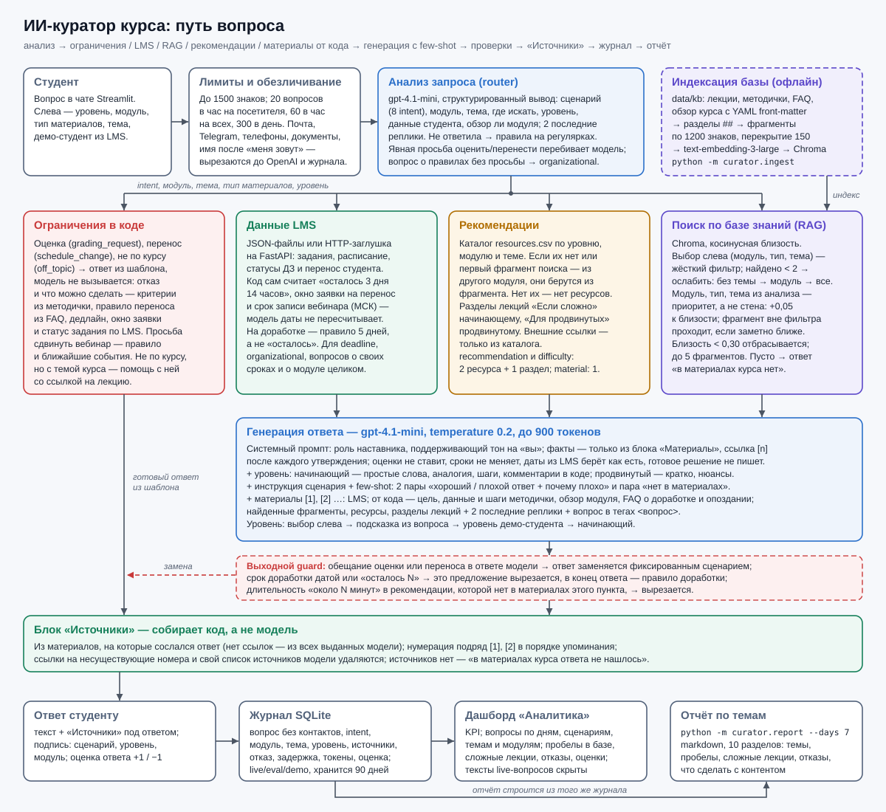

🇷🇺 [Русский](../ru/14-ai-curator.md) · 🇬🇧 [English](../en/14-ai-curator.md) · 🇪🇸 [Español](../es/14-ai-curator.md)

# Case Study: AI Curator for an Education Platform

**Showcase:** [ai-curator](https://github.com/alexanderomobile/ai-curator/blob/main/README.md)
**Status:** 🎓 Course project, demo is live, no real users

---

## Problem

AI curator for an online course: answers students' questions on course materials, deadlines and rules with a source for every answer, and suggests what to study next for their level.

## Features

RAG curator for the “Python for Data Analysis” course of a fictional school, “Data Academy”: answers from lectures, study guides, the FAQ and LMS data. Query analysis (gpt-4.1-mini with structured output, rule-based fallback) assigns each question to one of 8 scenarios: deadlines, difficulty, course material, recommendations, organizational questions, grading requests, extension requests, off-topic. The limits are enforced in code: the curator never grades and never moves deadlines — such requests get a template answer without the model, a model answer promising a grade or an extension is replaced, and the Sources block is assembled by code. Beginner and advanced levels: chosen in the UI or detected automatically from the student's wording, then from the LMS. RAG: 12 lectures, 4 study guides, a 63-question FAQ, text-embedding-3-large, Chroma with metadata search (module, topic, resource type) and a similarity threshold; 17 few-shot pairs of good and bad answers. LMS stub: schedule and assignments in JSON, JSON/CSV export, a FastAPI HTTP API; the time left until a deadline is computed by code. Questions are anonymized before they reach OpenAI; an SQLite log kept for 90 days feeds a Streamlit analytics dashboard and a topic report for the instructional designer. The demo runs Streamlit under systemd behind Cloudflare Tunnel.

## Business value

The goal is to take routine student questions off teachers and support: answers come from the course materials with a source, deadlines from the LMS, and the curator never promises grades or extensions; the instructional designer sees frequent topics and content gaps in the log. A course project on fictional data; on 44 held-out questions blind Claude judge models scored it 4.74 of 5 vs 3.82 for naive RAG, with 0 rule violations.

## Results

The held-out set of 44 questions (9 scenarios) was written by a separate Claude agent; the curator was not tuned on it, and it was run once on frozen code. Baseline: naive RAG on the same gpt-4.1-mini model and the same Chroma index, without query analysis, LMS, few-shot or code-enforced limits. Blind LLM-as-a-judge evaluation by three Claude judge agents, 132 comparisons: average over four criteria (correctness, completeness, rule compliance, helpfulness and tone) 4.74 of 5 vs 3.82; 95% of expected points covered vs 61%; rule violations 0 of 132 vs 19 of 132; the curator won 108 of 132 comparisons (82%), naive RAG 12, with 12 ties. Code checks: a Sources block in 44 of 44 answers, an honest “not in the materials” in 4 of 4 cases, 0 false refusals. The price: an answer costs 4.5 times more ($0.00304 vs $0.00068) and takes 1 s longer on average (3.2 s vs 2.2 s). The judges are models, not people: there was no human evaluation, the judges and the question-set authors come from the same model family (Claude), and run-to-run variance was not measured. Known errors (refusal templates firing too broadly, incomplete resource selection) are listed in the repository README.

## Links

- Code and documentation (in Russian): [github.com/alexanderomobile/ai-curator](https://github.com/alexanderomobile/ai-curator)
- Demo (Russian interface, up to 20 questions per hour): [curator.optimum-ltd.com](https://curator.optimum-ltd.com)
- Google Docs (in Russian): [prompt architecture and RAG design](https://docs.google.com/document/d/1W8aHKrNGa0gk_KIkr4i4ijbSL2v7D042FHnHj1NocvU/edit)

## Stack

See showcase README.

## Modules

Query analysis · 8 scenarios · Code-enforced limits · Levels · Metadata-filtered RAG · Few-shot · LMS stub · Log & dashboard

## Screenshots

## Run

See showcase README for run instructions.

---

[← Back to portfolio](https://github.com/alexanderomobile/portfolio/blob/main/README.en.md)
