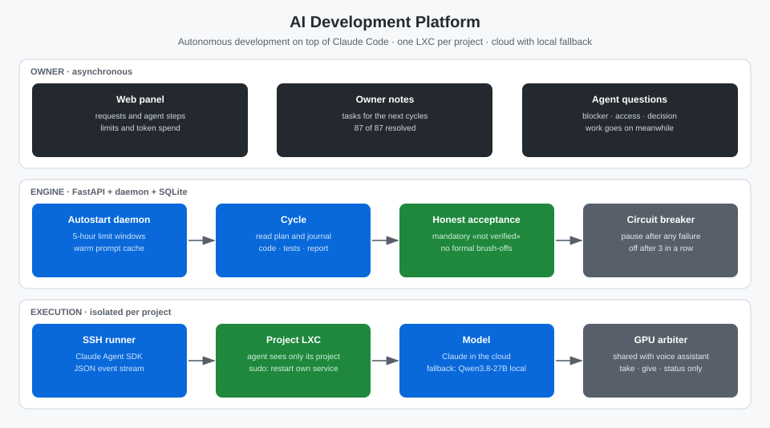

🇷🇺 [Русский](../ru/15-ai-dev-platform.md) · 🇬🇧 [English](../en/15-ai-dev-platform.md) · 🇪🇸 [Español](../es/15-ai-dev-platform.md)

# Case Study: AI Development Platform

**Status:** ✅ Internal tool in use · own server · closed source

---

## Problem

One person works across several projects, and Claude Code can write and check code on its own. But in an ordinary terminal the agent waits to be called: a task is set — the session ends — the next one starts when the owner is back at the computer. Meanwhile the subscription limit resets every five hours, and whatever is not spent within the window is lost.

What was needed was a platform that runs development by itself: it takes tasks from the project plan and from the owner's notes, works in limit windows, checks the result with tests, states honestly what was not verified, and asks questions asynchronously without stopping work. And all of it in such a way that an agent with full permissions cannot touch neighbouring projects or the server itself.

## Features

**Web panel.** A feed of the agent's requests and steps, the owner's notes, the agent's questions, limits and token spend for each project.

**Autorun.** A background daemon works in series of cycles within each five-hour limit window: the agent reads the project memory (plan and log), takes a task, writes code, runs the tests, records the outcome, and reports by itself when there are no tasks left.

**Orchestrator.** A second mode for large tasks: an architect builds a plan, role agents carry out the steps, a reviewer accepts the result.

**Asynchronous dialogue.** An agent's question is filed as a blocker, an access request or a decision and waits for an answer in the panel; work on everything else continues.

**Local model for when the cloud fails.** A "cloud while it answers, otherwise our own model" mode: Qwen3.8-27B on an owned GPU, 48–54 tokens per second.

## Business value

Development goes on while the owner is busy with other things: the subscription is used in full, tasks get closed overnight, and the owner is left with decisions and answering questions. Two production projects run on the platform — AutoFunnel and MuzloProm.

## Stack

Python · FastAPI · Claude Agent SDK · Claude Code · SQLite (WAL, FTS5) · vanilla JS · Proxmox VE (LXC per project) · systemd · SSH · Ollama · Qwen3.8-27B

## Engineering decisions

**An agent with full permissions is locked in its own container.** Autorun works without permission prompts, otherwise at night it would stall on the very first question. So each project lives in a separate LXC: the agent cannot see other projects or the host, can use sudo only to restart its own service, and sends nothing outward except a stream of events in JSON.

**A rhythm set by limit windows.** The daemon tracks the five-hour windows from the limit telemetry in the SDK: a series of cycles while the prompt cache is warm, then a wait for the reset. The volatile parts of the prompt are moved to the end so the cache is not invalidated on every cycle.

**Runaway protection, after a real incident.** When the network started answering with a 403 error, the daemon spun through 1304 cycles in 2.3 hours without a pause. After the post-mortem: a pause after any failure, the project is switched off after three failures in a row, and the limit is checked before start.

**Honest acceptance.** The agent's report must contain a "not verified" block, and a perfunctory entry there is not accepted. This way the owner sees where their attention is needed instead of reading "all done".

**One GPU for two projects.** The platform's local model and the voice assistant share one card through an arbiter: the platform takes it with a narrow SSH command that allows only "acquire", "release" and "status", and returns it after 10 minutes idle.

**The mode was chosen by the numbers.** A measurement showed that on small tasks the role-based orchestrator costs 5–7 times more than a single agent. So the main work runs in autorun, and the orchestrator is kept for large tasks.

## Metrics

| metric | value |
|---|---|
| Platform commits | **87** (6 Jul – 3 Nov 2026) |
| Platform code | about 9.4k lines |
| First month: requests to agents | 124, of which 101 in autorun |
| Autorun cycles in the first month | 78 completed · 16 paused on limit · 7 failed |
| Average cycle duration | about 20 minutes |
| Owner's notes resolved by 28 Aug 2026 | **87 of 87** |
| Production projects on the platform | 2 (AutoFunnel, MuzloProm) |
| Local model when the cloud fails | 48–54 tokens/s |

First-month spend by the SDK counter — about $778 at API rates. The work ran on a subscription; this money was not actually paid.

## Role

Owner and architect: setting the tasks, key decisions (autonomy, isolation, quality over savings), building the server. The platform code was written in Claude Code sessions under my direction.

## Screenshots

## Run

The platform is deployed on an owned Proxmox node. Addresses, credentials and source code are not published.

---

[← Back to portfolio](https://github.com/alexanderomobile/portfolio/blob/main/README.en.md)
