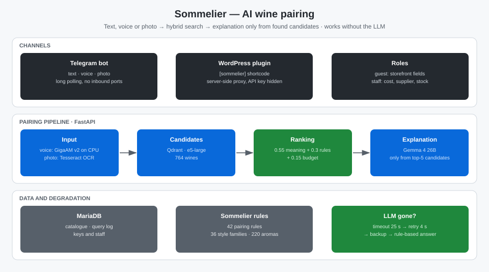

🇷🇺 [Русский](../ru/16-sommelier.md) · 🇬🇧 [English](../en/16-sommelier.md) · 🇪🇸 [Español](../es/16-sommelier.md)

# Case Study: Sommelier — AI Wine Recommendations

**Status:** 🧪 Pilot: deployed on 27 Aug 2026 on an owned server, rollout at the client not completed · closed source

---

## Problem

The client is a wine company with a WordPress website. There are two scenarios. A guest asks "what goes with duck under 5000" and wants clear advice, not a filter with twenty checkboxes. A restaurant has run out of a wine, and a staff member needs a replacement within a minute: a similar profile, a price within ±30%, in stock. Staff must see the purchase price and the supplier; a guest — never.

A separate condition: the language model sits on a GPU shared by several projects and can disappear at any moment. Recommendations must keep working when it does.

## Features

**Recommendations from text, voice and photo.** A request is typed, spoken, or made by photographing a label or a wine list. Voice is recognised on the CPU, photos are read with OCR, and from there everything follows the same recommendation path.

**Replacing an item.** A similar wine from the same style family, price ±30%, and sweetness stays within its own family so a dry wine is not replaced with a semi-sweet one.

**Explaining the choice.** The model briefly explains why this particular wine fits, but it chooses only from the five candidates the search found.

**Two channels.** A Telegram bot and a WordPress plugin with a shortcode: text, voice and photo right on the website page.

**Roles.** A guest sees the storefront fields; staff see the purchase price, the supplier and the stock level.

## Business value

The guest gets sommelier-level advice on the website and in the messenger, the restaurant finds a replacement for a sold-out item in a single request, and purchase prices do not leak into the browser.

## Stack

Python 3.12 · FastAPI · aiogram 3 · MariaDB · Qdrant · multilingual-e5-large · Gemma 4 26B (owned GPU) · GigaAM v2 (speech, ONNX on CPU) · Tesseract · WordPress plugin (PHP, JS) · Proxmox LXC · systemd · Cloudflare Tunnel

## Engineering decisions

**The model cannot invent a wine.** It receives only the top 5 candidates from the catalogue and explains the choice among them. This is covered by an integration test with a wine known to be absent.

**Recommendations work without the model too.** The fallback chain: 25 s timeout → retry after 4 s → fallback model endpoint → rule-based parsing of the request and an honest templated answer.

**Photos without a vision model.** There is no free video memory, and a label or a wine list is text. So OCR takes the place of a vision model, and the recognised text follows the common recommendation path.

**Hybrid ranking.** Final score: 0.55 semantic similarity + 0.3 sommelier rules + 0.15 budget fit. The dish category sets requirements for body, acidity and tannins. If there are too few candidates, filters are relaxed one at a time.

**Purchase prices are protected at a single point.** Fields are stripped by role in one function, and this is covered by a test. The plugin keeps the API key on the website's server, rate-limits by IP and exposes only the storefront fields.

**The catalogue was built through research.** Three passes of agents (38 agents, every result checked by a critic) assembled the methodology and the catalogue: 764 wines from 294 wineries in 28 countries, each with a strict profile. Duplicates and defects at merge — 0.

## Metrics

| metric | value |
|---|---|
| Wines in the catalogue · wineries · countries | **764** · 294 · 28 |
| Machine-readable sommelier rules | 42 pairing rules · 36 style families · 220 aromas |
| Load test through the public address | **24 of 24** requests at 6 concurrent, 11.9 s on average |
| Tests | 15 unit and 2 integration, type check — 0 errors |

The load test is synthetic: the pilot has not received live traffic yet. The bottleneck is the shared language model, two calls per request.

## Role

Project owner who set the work: requirements, decisions on architecture and degradation, deployment on an owned server. The code was written in Claude Code sessions under my direction.

## Screenshots

## Run

Deployed on an owned Proxmox node, reachable from outside only through the tunnel. Addresses, keys and client data are not published.

---

[← Back to portfolio](https://github.com/alexanderomobile/portfolio/blob/main/README.en.md)
