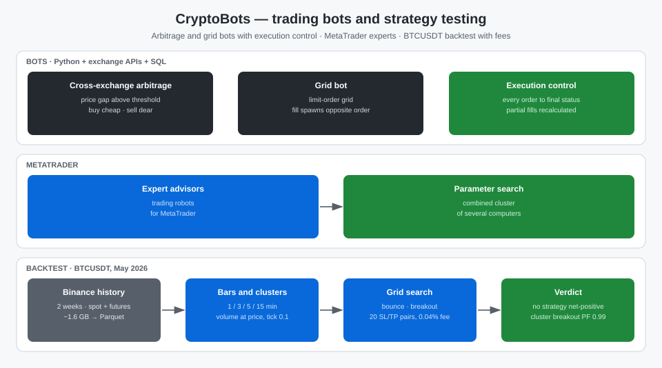

🇷🇺 [Русский](../ru/17-crypto-trading-bots.md) · 🇬🇧 [English](../en/17-crypto-trading-bots.md) · 🇪🇸 [Español](../es/17-crypto-trading-bots.md)

# Case Study: CryptoBots — Trading Bots and Strategy Testing

**Status:** Bots — early projects, source code unavailable, described by the author · 2026 backtest — with figures

---

## Problem

A trading bot loses money not so much on a bad idea as on execution: an order filled only partially, the exchange answered with a delay, the connection dropped between the two legs of a trade. And for a second reason: the strategy is launched before it has been tested on history with fees.

## Features

**Cross-exchange arbitrage.** The bot watches the price of one asset on several exchanges and, when the gap exceeds a threshold, buys where it is cheaper and sells where it is dearer.

**Grid bot.** A grid of limit orders around the price: every filled buy spawns a sell one level higher, and vice versa.

**Order execution control.** Every order is tracked to its final status, partial fills included. The order's remainder and the opposite leg are recalculated from the volume actually filled, not the volume requested. Order state is kept in an SQL database.

**Expert Advisors for MetaTrader.** Trading robots for the MetaTrader terminal. Their parameters were optimised on a combined cluster of several computers, so that a search took hours rather than days.

**Scalping backtest (2026).** A separate project testing strategies on BTCUSDT history — described below with figures.

## Business value

The bot trades around the clock and does not get nervous, but the main thing is that it leaves no "dangling" remainders after an order is partially filled. And a backtest with fees cuts a strategy off before real money is lost on it.

## Stack

Python · exchange REST APIs · SQL · MetaTrader · parameter optimisation cluster · pandas · NumPy · Parquet · MySQL

## BTCUSDT scalping backtest (May 2026)

**Data.** BTCUSDT trade history from Binance's public archive over two weeks: spot and USDT-M futures, about 1.6 GB of raw CSV, converted to Parquet.

**Features.** One-minute candles and cluster profiles (volume at price with a 0.1 step) on 1, 3, 5 and 15-minute timeframes.

**Strategies.** Level bounce and level breakout, long and short. For each, a grid of 20 stop-loss and take-profit combinations, a taker fee of 0.04% per side, holding for no longer than two hours, a pause after a trade.

**Storage.** Runs, trades and equity curves are written to MySQL and exported for charts. Along the way, recommended parameters for a scalping terminal were calculated from the same history.

**The result, honestly.** After fees, not one strategy came out positive. Cluster analysis noticeably improved the breakout on futures: the profit factor rose from 0.45 on ordinary candles to 0.99 on clusters, and the loss over the period shrank from −4.1% to −0.05%. That is still not enough for real money, so the strategy did not go into trading. The backtest did its job: it saved the deposit.

## Metrics

| metric | value |
|---|---|
| Bot types | arbitrage · grid · MetaTrader Expert Advisors |
| Execution control | to final status, partial fills included |
| Backtest: history | 2 weeks of BTCUSDT, spot and futures, ~1.6 GB |
| Backtest: SL/TP combinations per strategy | 20 |
| Breakout on clusters vs on candles | profit factor **0.99** vs 0.45 |

## Screenshots

## Run

The bots' source code is unavailable and is not published. The backtest is a personal research project.

---

[← Back to portfolio](https://github.com/alexanderomobile/portfolio/blob/main/README.en.md)
