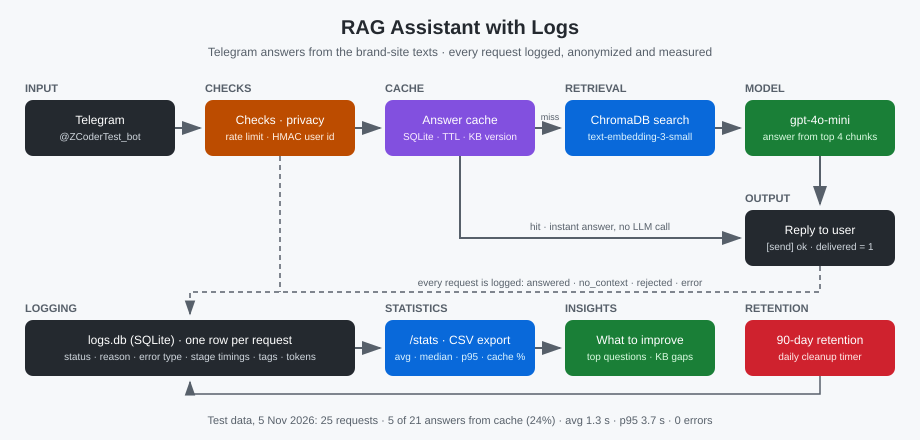

🇷🇺 [Русский](../ru/11-rag-assistant-logs.md) · 🇬🇧 [English](../en/11-rag-assistant-logs.md) · 🇪🇸 [Español](../es/11-rag-assistant-logs.md)

# Case Study: RAG Assistant with Logs

**Showcase:** [rag-assistant-logs](https://github.com/alexanderomobile/rag-assistant-logs/blob/main/README.md)
**Status:** ✅ Production

---

## Problema

Asistente de Telegram sobre servicios que registra cada consulta y lleva estadísticas.

## Funcionalidad

El bot @ZCoderTest_bot responde preguntas sobre los servicios de Alexander a partir de los textos de su web (RAG: ChromaDB, embeddings OpenAI text-embedding-3-small, gpt-4o-mini), con caché de respuestas en SQLite. Cada consulta se registra en SQLite: estado, motivo, tipo de error, tiempos por etapa, etiquetas. ID de usuario anonimizado (HMAC), contactos eliminados del texto, retención de 90 días por temporizador, /stats. Servicio systemd en un servidor Proxmox doméstico.

## Valor de negocio

Muestra qué preguntan los clientes potenciales, qué falta en los materiales y la rapidez de respuesta; las preguntas repetidas se responden al instante desde la caché. Datos de prueba del 5 nov 2026: mediana de respuesta 1,2 s, 7 de 26 respuestas desde la caché, 0 errores.

## Resultados

Datos de prueba del 5 nov 2026 (aún sin clientes reales): 31 consultas, 21 de demostración y 10 en Telegram; 26 respuestas desde la base, 7 de ellas desde la caché (27 %); mediana de respuesta 1,2 s, media 1,4 s; 4 preguntas sin respuesta en la base (2 fuera de tema, 1 servicio no descrito, 1 petición de llamada) pasaron a la lista «qué añadir»; 1 pregunta rechazada por demasiado larga; 0 errores. Los logs mostraron un bloqueo de conexión a la API de 60,8 s (corregido con un timeout de conexión de 5 s y reintento; un bloqueo posterior costó 10,5 s) y una respuesta tomada del caso equivocado (los casos de la base se reorganizaron).

## Stack

See showcase README.

## Módulos

RAG · Caché de respuestas · Registro de consultas · Estadísticas · Anonimización · Retención 90 días

## Capturas

## Ejecución

See showcase README for run instructions.

---

[← Volver al portfolio](https://github.com/alexanderomobile/portfolio/blob/main/README.es.md)
