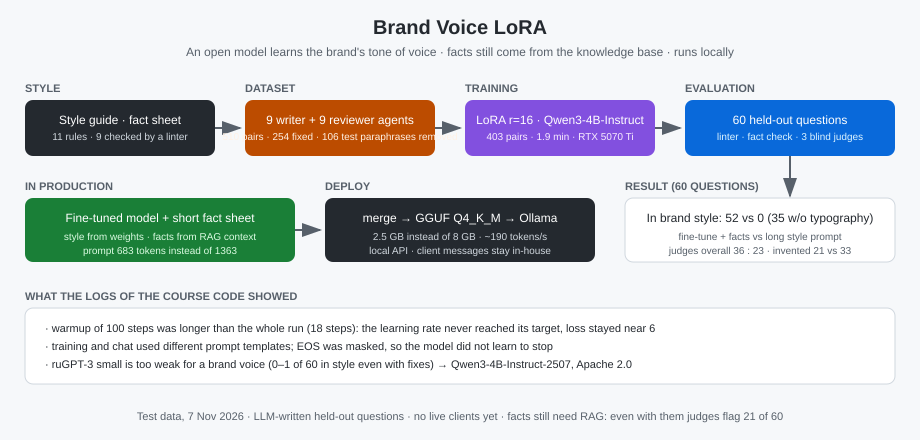

🇷🇺 [Русский](../ru/12-brand-voice-lora.md) · 🇬🇧 [English](../en/12-brand-voice-lora.md) · 🇪🇸 [Español](../es/12-brand-voice-lora.md)

# Case Study: Brand Voice LoRA

**Showcase:** [brand-voice-lora](https://github.com/alexanderomobile/brand-voice-lora/blob/main/README.md)
**Status:** 🧪 Funciona en un servidor propio, aún sin clientes reales

---

## Problema

Un modelo abierto responde con el tono de voz de la marca: ajuste fino LoRA y despliegue local.

## Funcionalidad

Qwen3-4B-Instruct-2507 ajustado con LoRA para responder con la voz del asistente de Alexander (automatización con IA para inmobiliarias): breve, cortés, sin publicidad ni formato, con un siguiente paso al final. El dataset de 403 pares lo escribieron y revisaron agentes Claude a partir de una guía de estilo y una hoja de hechos; las paráfrasis de las preguntas de prueba se detectaron con embeddings y se eliminaron. Evaluación con 60 preguntas reservadas: linter de estilo, verificación automática de cifras y contactos, jueces LLM a ciegas. El modelo se convirtió a GGUF Q4_K_M y funciona en Ollama en un servidor propio.

## Valor de negocio

El propio modelo mantiene el estilo de la marca en lugar de un prompt largo: la petición es la mitad de larga y los mensajes de clientes no salen de casa. Datos de prueba del 7 nov 2026: 52 de 60 respuestas con el estilo frente a 0 con el prompt largo; los hechos siguen viniendo de la base de conocimiento.

## Resultados

Datos de prueba del 7 nov 2026 (aún sin clientes reales), 60 preguntas reservadas; las paráfrasis encontradas en el entrenamiento se eliminaron. Con una hoja de hechos breve, el modelo ajustado responde con el estilo de la marca en 52 de 60 casos (variantes del mismo modelo: de 47 a 56); el modelo base con un prompt de estilo largo y los mismos hechos, en 0 (35 sin contar la tipografía); el prompt ocupa 683 tokens en lugar de 1363. Jueces a ciegas (3 agentes Claude por par, cada uno con su propio orden): estilo 59 : 1 y en general 36 : 23 a favor del ajuste, utilidad igualada (25 : 28). Incluso con la hoja de hechos los jueces marcaron una invención en 21 de 60 respuestas (33 con el prompt); sin ella el modelo inventa datos de la marca, así que los hechos deben venir de la base de conocimiento (RAG). Entrenamiento: 1,9 min en una RTX 5070 Ti; en Ollama el modelo Q4_K_M pesa 2,5 GB y genera unos 190 tokens/s. Una revisión independiente detectó en la primera versión fugas de preguntas de prueba al entrenamiento; se eliminaron y el modelo se reentrenó.

## Stack

See showcase README.

## Módulos

Guía de estilo · Dataset por agentes · Auditoría de fugas · LoRA · Jueces a ciegas · Ollama

## Capturas

## Ejecución

See showcase README for run instructions.

---

[← Volver al portfolio](https://github.com/alexanderomobile/portfolio/blob/main/README.es.md)
