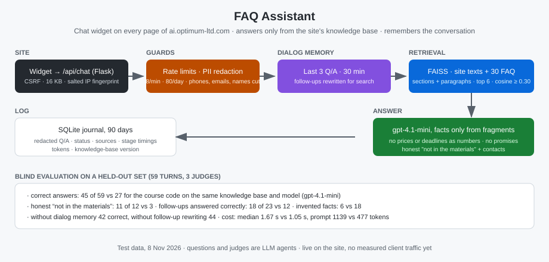

🇷🇺 [Русский](../ru/13-faq-assistant.md) · 🇬🇧 [English](../en/13-faq-assistant.md) · 🇪🇸 [Español](../es/13-faq-assistant.md)

# Case Study: FAQ Assistant

**Showcase:** [faq-assistant](https://github.com/alexanderomobile/faq-assistant/blob/main/README.md)
**Status:** 🧪 En producción en ai.optimum-ltd.com, evaluado con preguntas de prueba

---

## Problema

Asistente de chat en la web: responde desde la base de conocimiento, recuerda la conversación y entiende las preguntas de seguimiento.

## Funcionalidad

Un widget en la esquina inferior derecha de cada página de ai.optimum-ltd.com llama al /api/chat del propio sitio (Flask, CSRF, límite de tamaño); el sitio reenvía la pregunta a un asistente FastAPI que solo escucha en 127.0.0.1. Búsqueda FAISS en los textos del sitio y 30 preguntas frecuentes: secciones y sus párrafos, text-embedding-3-large, 6 fragmentos, umbral de similitud. Memoria de los tres últimos pares pregunta-respuesta; una pregunta de seguimiento como «¿y el segundo?» se reescribe como pregunta completa antes de buscar. gpt-4.1-mini responde solo con los fragmentos encontrados, sin precios ni promesas. Los contactos del visitante se eliminan antes de OpenAI, registro anonimizado en SQLite durante 90 días, límites de mensajes. Basado en el código del curso pcef9, que no tenía memoria de diálogo.

## Valor de negocio

El visitante obtiene respuestas sobre servicios, casos y cómo empezar en el propio sitio, también a preguntas cortas de seguimiento, sin precios ni promesas inventados; si los materiales no tienen la respuesta, el asistente lo dice y da los contactos. Datos de prueba del 8 nov 2026: 45 de 59 respuestas correctas frente a 27 del código del curso, invenciones en 6 respuestas frente a 18.

## Resultados

Datos de prueba del 8 nov 2026 (todavía casi sin visitantes reales). Conjunto reservado B, 59 turnos: 24 preguntas y 12 diálogos con preguntas de seguimiento, escrito por un agente Claude a partir de los textos del sitio después del desarrollo y ejecutado una sola vez; lo evaluaron 3 jueces-agentes a ciegas, cada uno con su propio orden. El asistente responde correctamente 45 de 59, el código del curso con la misma base y el mismo modelo 27; dice honestamente que los materiales no tienen la respuesta en 11 de 12 casos (código del curso: 3); responde bien a 18 de 23 preguntas de seguimiento (12); inventa en 6 respuestas (18). Sin memoria de diálogo: 42 correctas; sin reescritura de preguntas de seguimiento: 44. Coste: mediana de respuesta 1,67 s en lugar de 1,05 s, prompt de 1139 tokens en lugar de 477. En el conjunto A, usado durante el desarrollo, la versión 1 obtuvo 52 de 60 y la 2, 57.

## Stack

See showcase README.

## Módulos

RAG · Memoria de diálogo · Reescritura de seguimiento · Anonimización · Registro · Widget web

## Capturas

## Ejecución

See showcase README for run instructions.

---

[← Volver al portfolio](https://github.com/alexanderomobile/portfolio/blob/main/README.es.md)
