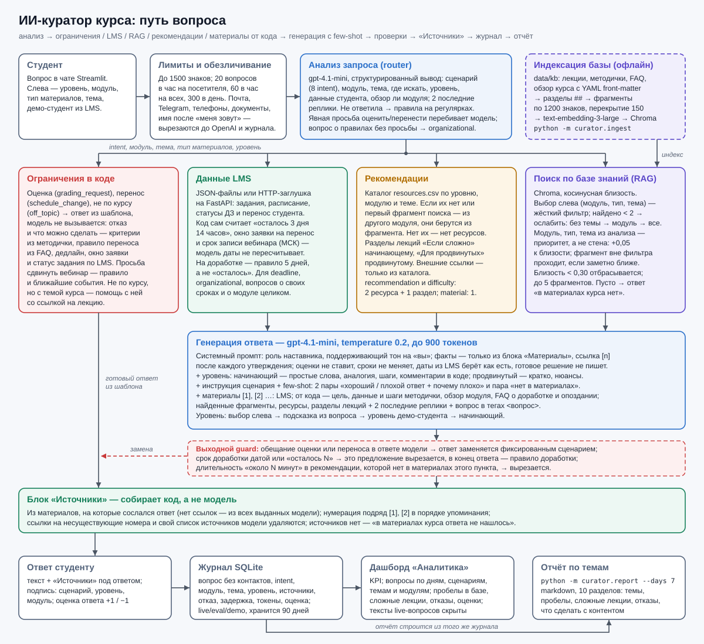

🇷🇺 [Русский](../ru/14-ai-curator.md) · 🇬🇧 [English](../en/14-ai-curator.md) · 🇪🇸 [Español](../es/14-ai-curator.md)

# Case Study: Tutor con IA para una plataforma educativa

**Showcase:** [ai-curator](https://github.com/alexanderomobile/ai-curator/blob/main/README.md)
**Status:** 🎓 Proyecto formativo, demo en funcionamiento, sin usuarios reales

---

## Problema

Tutor con IA para un curso en línea: responde a los estudiantes sobre materiales, plazos y normas del curso citando siempre la fuente y recomienda qué estudiar después según su nivel.

## Funcionalidad

Tutor RAG del curso «Python para análisis de datos» de una escuela ficticia, «Academia de Datos»: responde a partir de clases, guías de prácticas, FAQ y datos del LMS. El análisis de la consulta (gpt-4.1-mini con salida estructurada y reglas de respaldo) asigna cada pregunta a uno de 8 escenarios: plazos, dificultad, materiales del curso, recomendaciones, cuestiones organizativas, petición de nota, petición de aplazamiento y preguntas ajenas al curso. Las restricciones las impone el código: el tutor no pone notas ni cambia plazos —esas peticiones reciben una plantilla sin modelo—, una respuesta del modelo que prometa nota o aplazamiento se sustituye y el bloque «Fuentes» lo arma el código. Niveles principiante y avanzado: se eligen en la interfaz o se detectan automáticamente por las palabras del estudiante y luego por el LMS. RAG: 12 clases, 4 guías de prácticas, FAQ de 63 preguntas, text-embedding-3-large, Chroma con búsqueda por metadatos (módulo, tema, tipo de recurso) y umbral de similitud; 17 pares few-shot de respuesta buena y mala. Stub de LMS: horario y tareas en JSON, exportación JSON/CSV, API HTTP en FastAPI; el tiempo que queda hasta cada plazo lo calcula el código. Las preguntas se anonimizan antes de llegar a OpenAI; el registro en SQLite se guarda 90 días y alimenta un panel de analítica en Streamlit y un informe por temas para el diseñador instruccional. La demo es Streamlit bajo systemd detrás de Cloudflare Tunnel.

## Valor de negocio

El objetivo es quitar a profesores y soporte las preguntas rutinarias de los estudiantes: respuestas desde los materiales del curso con su fuente, plazos desde el LMS, y el tutor nunca promete notas ni aplazamientos; el diseñador instruccional ve en el registro los temas frecuentes y las lagunas del contenido. Proyecto formativo con datos ficticios; con 44 preguntas reservadas, jueces-modelo Claude a ciegas le dieron 4,74 de 5 frente a 3,82 de un RAG ingenuo, con 0 infracciones de las reglas.

## Resultados

El conjunto reservado de 44 preguntas (9 escenarios) lo escribió un agente Claude aparte; el tutor no se ajustó con él y se ejecutó una sola vez con el código congelado. Referencia: un RAG ingenuo con el mismo modelo gpt-4.1-mini y el mismo índice Chroma, sin análisis de la consulta, LMS, few-shot ni restricciones en código. Evaluación a ciegas LLM-as-a-judge por tres agentes-jueces Claude, 132 comparaciones: media de cuatro criterios (corrección, exhaustividad, cumplimiento de las reglas, utilidad y tono) 4,74 de 5 frente a 3,82; 95 % de los puntos esperados cubiertos frente a 61 %; infracciones de las reglas 0 de 132 frente a 19 de 132; el tutor ganó 108 de 132 comparaciones (82 %), el RAG ingenuo 12 y hubo 12 empates. Comprobaciones por código: bloque «Fuentes» en 44 de 44 respuestas, un «no está en los materiales» honesto en 4 de 4 casos, 0 rechazos falsos. El precio: cada respuesta cuesta 4,5 veces más (0,00304 USD frente a 0,00068 USD) y tarda de media 1 s más (3,2 s frente a 2,2 s). Los jueces son modelos, no personas: no hubo evaluación humana, jueces y autores de los conjuntos pertenecen a la misma familia de modelos (Claude) y la variación entre ejecuciones no se midió. Los errores conocidos (plantillas de rechazo que se activan de más, selección incompleta de recursos) se describen en el README del repositorio.

## Enlaces

- Código y documentación (en ruso): [github.com/alexanderomobile/ai-curator](https://github.com/alexanderomobile/ai-curator)
- Demo (interfaz en ruso, hasta 20 preguntas por hora): [curator.optimum-ltd.com](https://curator.optimum-ltd.com)
- Google Docs (en ruso): [arquitectura de prompts y esquema RAG](https://docs.google.com/document/d/1W8aHKrNGa0gk_KIkr4i4ijbSL2v7D042FHnHj1NocvU/edit)

## Stack

See showcase README.

## Módulos

Análisis de consulta · 8 escenarios · Restricciones en código · Niveles · RAG con metadatos · Few-shot · Stub de LMS · Registro y panel

## Capturas

## Ejecución

See showcase README for run instructions.

---

[← Volver al portfolio](https://github.com/alexanderomobile/portfolio/blob/main/README.es.md)
