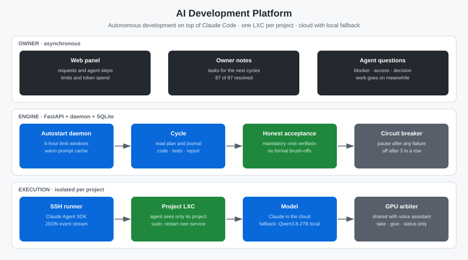

🇷🇺 [Русский](../ru/15-ai-dev-platform.md) · 🇬🇧 [English](../en/15-ai-dev-platform.md) · 🇪🇸 [Español](../es/15-ai-dev-platform.md)

# Case Study: Plataforma de desarrollo con IA

**Status:** ✅ Herramienta interna en uso · servidor propio · código cerrado

---

## Problema

Una sola persona trabaja en varios proyectos, y Claude Code sabe escribir y comprobar código por sí mismo. Pero en una terminal normal el agente espera a que lo llamen: se plantea la tarea — la sesión termina — la siguiente empieza cuando el propietario vuelve al ordenador. Mientras tanto, el límite de la suscripción se reinicia cada cinco horas, y todo lo que no se gasta dentro de la ventana se pierde.

Hacía falta una plataforma que llevara el desarrollo por sí sola: que tomara tareas del plan del proyecto y de las observaciones del propietario, trabajara por ventanas de límite, comprobara el resultado con tests, dijera con honestidad qué no se ha comprobado e hiciera preguntas de forma asíncrona sin detener el trabajo. Y todo ello de modo que un agente con permisos completos no pudiera afectar a los proyectos vecinos ni al propio servidor.

## Funcionalidad

**Panel web.** Un flujo con las peticiones y los pasos del agente, las observaciones del propietario, las preguntas del agente, los límites y el gasto de tokens de cada proyecto.

**Ejecución automática.** Un demonio en segundo plano trabaja en series de ciclos dentro de cada ventana de límite de cinco horas: el agente lee la memoria del proyecto (plan y registro), toma una tarea, escribe código, ejecuta los tests, anota el resultado y avisa por sí mismo cuando ya no quedan tareas.

**Orquestador.** Un segundo modo para tareas grandes: un arquitecto elabora el plan, agentes con roles ejecutan los pasos y un revisor acepta el resultado.

**Diálogo asíncrono.** La pregunta del agente se registra como bloqueo, acceso o decisión y espera respuesta en el panel; el trabajo en lo demás continúa.

**Modelo local por si falla la nube.** Modo «la nube mientras responda; si no, el modelo propio»: Qwen3.8-27B en una tarjeta gráfica propia, 48–54 tokens por segundo.

## Valor de negocio

El desarrollo avanza mientras el propietario se ocupa de otras cosas: la suscripción se aprovecha entera, las tareas se cierran de noche y al propietario le quedan las decisiones y las respuestas a las preguntas. En la plataforma se llevan dos proyectos en producción: AutoFunnel y MuzloProm.

## Stack

Python · FastAPI · Claude Agent SDK · Claude Code · SQLite (WAL, FTS5) · JS vanilla · Proxmox VE (un LXC por proyecto) · systemd · SSH · Ollama · Qwen3.8-27B

## Decisiones de ingeniería

**El agente con permisos completos, encerrado en su contenedor.** La ejecución automática funciona sin pedir permisos; de lo contrario, de noche se detendría en la primera pregunta. Por eso cada proyecto vive en un LXC aparte: el agente no ve otros proyectos ni el host, con sudo solo puede reiniciar su propio servicio y hacia fuera solo entrega un flujo de eventos en JSON.

**Ritmo marcado por las ventanas de límite.** El demonio calcula las ventanas de cinco horas a partir de la telemetría de límites del SDK: una serie de ciclos mientras la caché del prompt está caliente y después espera al reinicio. Las partes variables del prompt van al final para que la caché no se invalide en cada ciclo.

**Protección contra el embalamiento, tras un incidente real.** Cuando la red empezó a responder con error 403, el demonio encadenó sin pausa 1304 ciclos en 2,3 horas. Tras el análisis: pausa después de cualquier fallo, el proyecto se desactiva tras tres fallos seguidos y antes de arrancar se comprueba el límite.

**Aceptación honesta.** El informe del agente debe incluir un bloque «no comprobado», y en él no se acepta una respuesta de trámite. Así el propietario ve dónde hace falta su mirada, en lugar de leer «todo listo».

**Una tarjeta gráfica para dos proyectos.** El modelo local de la plataforma y el asistente de voz comparten una tarjeta mediante un árbitro: la plataforma la toma con un comando SSH restringido que solo permite «tomar», «liberar» y «estado», y la devuelve tras 10 minutos de inactividad.

**El modo se eligió por las cifras.** Una medición mostró que en tareas pequeñas el orquestador con roles cuesta 5–7 veces más que un solo agente. Por eso el trabajo principal va en ejecución automática, y el orquestador queda para las tareas grandes.

## Métricas

| indicador | valor |
|---|---|
| Commits de la plataforma | **87** (06.07–03.11.2026) |
| Código de la plataforma | unas 9,4 mil líneas |
| Primer mes: peticiones a los agentes | 124, de ellas 101 en ejecución automática |
| Ciclos de ejecución automática del primer mes | 78 completados · 16 en pausa por límite · 7 con fallo |
| Duración media de un ciclo | unos 20 minutos |
| Observaciones del propietario resueltas a 28.08.2026 | **87 de 87** |
| Proyectos en producción en la plataforma | 2 (AutoFunnel, MuzloProm) |
| Modelo local si falla la nube | 48–54 tokens/s |

El gasto del primer mes según el contador del SDK fue de unos 778 $ a tarifas de la API. El trabajo se hizo con suscripción; ese dinero no se pagó realmente.

## Rol

Propietario y arquitecto: planteamiento de las tareas, decisiones clave (autonomía, aislamiento, prioridad de la calidad sobre el ahorro), montaje del servidor. El código de la plataforma se escribió en sesiones de Claude Code bajo mi dirección.

## Capturas

## Ejecución

La plataforma está desplegada en un nodo Proxmox propio. Direcciones, credenciales y código fuente no se publican.

---

[← Volver al portfolio](https://github.com/alexanderomobile/portfolio/blob/main/README.es.md)
