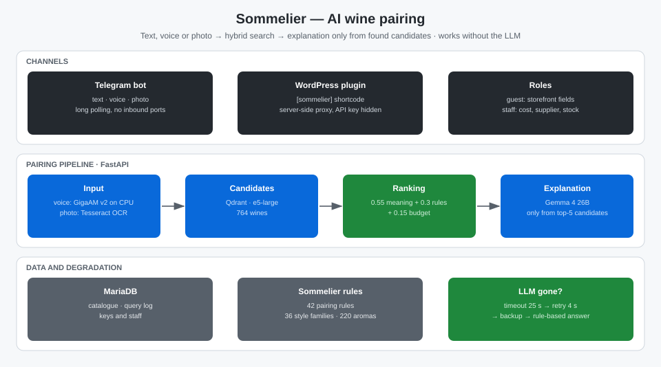

🇷🇺 [Русский](../ru/16-sommelier.md) · 🇬🇧 [English](../en/16-sommelier.md) · 🇪🇸 [Español](../es/16-sommelier.md)

# Case Study: Sommelier — recomendación de vinos con IA

**Status:** 🧪 Piloto: desplegado el 27.08.2026 en un servidor propio, la implantación en el cliente no ha concluido · código cerrado

---

## Problema

El cliente es una empresa de vinos con un sitio en WordPress. Hay dos escenarios. Un visitante pregunta «qué tomo con pato por menos de 5000» y quiere un consejo claro, no un filtro de veinte casillas. En un restaurante se ha agotado una referencia, y un empleado necesita un sustituto en un minuto: perfil parecido, precio dentro de ±30%, disponible. Además, el empleado debe ver el precio de compra y el proveedor, y el visitante, nunca.

Una condición aparte: el modelo de lenguaje está en una tarjeta gráfica compartida por varios proyectos y puede desaparecer en cualquier momento. La recomendación debe seguir funcionando aun así.

## Funcionalidad

**Recomendación por texto, voz y foto.** La petición se escribe, se dicta o se hace fotografiando la etiqueta o la carta de vinos. La voz se reconoce en el procesador, la foto se lee con OCR, y a partir de ahí todo sigue el mismo camino de recomendación.

**Sustitución de una referencia.** Un vino parecido por familia de estilo, precio ±30%, y el dulzor se mantiene dentro de su familia, para que un seco no se sustituya por un semidulce.

**Explicación de la elección.** El modelo explica brevemente por qué encaja precisamente ese vino, pero solo elige entre los cinco candidatos que encontró la búsqueda.

**Dos canales.** Un bot de Telegram y un plugin de WordPress con shortcode: texto, voz y foto directamente en la página del sitio.

**Roles.** El visitante ve los campos de escaparate; el empleado, el precio de compra, el proveedor y las existencias.

## Valor de negocio

El visitante recibe un consejo de nivel sumiller en el sitio y en la mensajería, el restaurante encuentra un sustituto para una referencia agotada con una sola petición, y los precios de compra no se filtran al navegador.

## Stack

Python 3.12 · FastAPI · aiogram 3 · MariaDB · Qdrant · multilingual-e5-large · Gemma 4 26B (tarjeta gráfica propia) · GigaAM v2 (voz, ONNX en CPU) · Tesseract · plugin de WordPress (PHP, JS) · Proxmox LXC · systemd · Cloudflare Tunnel

## Decisiones de ingeniería

**El modelo no puede inventarse un vino.** Solo recibe los 5 mejores candidatos del catálogo y explica la elección entre ellos. Lo cubre un test de integración con un vino que se sabe ausente.

**La recomendación funciona también sin el modelo.** Cadena ante fallos: timeout de 25 s → reintento a los 4 s → dirección de reserva del modelo → análisis de la petición con reglas y una respuesta honesta de plantilla.

**Fotos sin modelo de visión.** No queda memoria de vídeo libre, y una etiqueta o una carta de vinos son texto. Por eso, en lugar de un modelo de visión hay OCR, y el texto reconocido sigue el camino común de recomendación.

**Ranking híbrido.** Puntuación final: 0,55 de proximidad semántica + 0,3 de reglas de sumiller + 0,15 de ajuste al presupuesto. La categoría del plato fija los requisitos de cuerpo, acidez y taninos. Si hay pocos candidatos, los filtros se relajan de uno en uno.

**Los precios de compra se protegen en un único punto.** Los campos se recortan por rol en una sola función, cubierta por un test. El plugin guarda la clave de API en el servidor del sitio, limita la frecuencia por IP y hacia fuera solo entrega los campos de escaparate.

**El catálogo se construyó mediante investigación.** Tres pasadas de agentes (38 agentes, cada resultado revisado por un crítico) reunieron la metodología y el catálogo: 764 vinos de 294 bodegas de 28 países, cada uno con un perfil estricto. Duplicados y defectos al fusionar: 0.

## Métricas

| indicador | valor |
|---|---|
| Vinos en el catálogo · bodegas · países | **764** · 294 · 28 |
| Reglas de sumiller legibles por máquina | 42 reglas de maridaje · 36 familias de estilo · 220 aromas |
| Prueba de carga a través de la dirección pública | **24 de 24** peticiones con 6 en paralelo, 11,9 s de media |
| Tests | 15 unitarios y 2 de integración, verificación de tipos: 0 errores |

La prueba de carga es sintética: el piloto aún no ha recibido tráfico real. El cuello de botella es el modelo de lenguaje compartido, con dos llamadas por petición.

## Rol

Propietario del proyecto y responsable del planteamiento: requisitos, decisiones de arquitectura y de degradación, despliegue en un servidor propio. El código se escribió en sesiones de Claude Code bajo mi dirección.

## Capturas

## Ejecución

Desplegado en un nodo Proxmox propio, accesible desde fuera solo a través del túnel. Direcciones, claves y datos del cliente no se publican.

---

[← Volver al portfolio](https://github.com/alexanderomobile/portfolio/blob/main/README.es.md)
