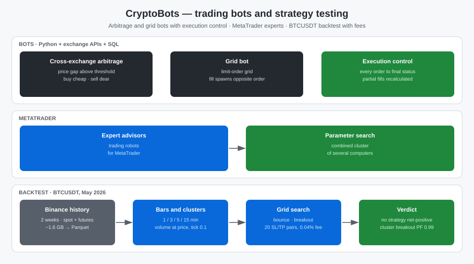

🇷🇺 [Русский](../ru/17-crypto-trading-bots.md) · 🇬🇧 [English](../en/17-crypto-trading-bots.md) · 🇪🇸 [Español](../es/17-crypto-trading-bots.md)

# Case Study: CryptoBots — bots de trading y prueba de estrategias

**Status:** Bots — proyectos tempranos, código fuente no disponible, descripción del autor · backtest de 2026 — con cifras

---

## Problema

Un bot de trading pierde dinero no tanto por una mala idea como por la ejecución: una orden se ejecutó solo en parte, el exchange respondió con retraso, la conexión se cortó entre las dos patas de la operación. Y por una segunda causa: la estrategia se lanza antes de haberla comprobado sobre el histórico con comisiones.

## Funcionalidad

**Arbitraje entre exchanges.** El bot sigue el precio de un mismo activo en varios exchanges y, cuando la diferencia supera un umbral, compra donde está más barato y vende donde está más caro.

**Bot de grid.** Una cuadrícula de órdenes limitadas alrededor del precio: cada compra ejecutada genera una venta un nivel más arriba, y viceversa.

**Control de ejecución de órdenes.** Cada orden se sigue hasta su estado final, incluida la ejecución parcial. El resto de la orden y la pata contraria se recalculan según el volumen realmente ejecutado, no el solicitado. El estado de las órdenes se guarda en una base de datos SQL.

**Asesores expertos para MetaTrader.** Robots de trading para el terminal MetaTrader. La optimización de sus parámetros se hacía en un clúster formado por varios ordenadores, para que la búsqueda llevara horas y no días.

**Backtest de scalping (2026).** Un proyecto aparte de prueba de estrategias sobre el histórico de BTCUSDT — descrito más abajo con cifras.

## Valor de negocio

El bot opera las 24 horas y no se pone nervioso, pero lo principal es que no deja restos «colgados» tras la ejecución parcial de una orden. Y un backtest con comisiones descarta una estrategia antes de que se pierda dinero real con ella.

## Stack

Python · APIs REST de exchanges · SQL · MetaTrader · clúster de optimización de parámetros · pandas · NumPy · Parquet · MySQL

## Backtest de scalping BTCUSDT (mayo de 2026)

**Datos.** Histórico de operaciones de BTCUSDT del archivo público de Binance durante dos semanas: spot y futuros USDT-M, unos 1,6 GB de CSV en bruto, pasados a Parquet.

**Variables.** Velas de un minuto y perfiles de clúster (volumen por precio con paso de 0,1) en marcos temporales de 1, 3, 5 y 15 minutos.

**Estrategias.** Rebote en un nivel y ruptura de un nivel, en largo y en corto. Para cada una, una cuadrícula de 20 combinaciones de stop-loss y take-profit, comisión taker del 0,04% por lado, mantenimiento de la posición no más de dos horas y pausa tras cada operación.

**Almacenamiento.** Ejecuciones, operaciones y curvas de rentabilidad se escriben en MySQL y se exportan para los gráficos. De paso, con el mismo histórico se calcularon parámetros recomendados para un terminal de scalping.

**El resultado, honesto.** Tras comisiones, ninguna estrategia quedó en positivo. El análisis de clústeres mejoró notablemente la ruptura en futuros: el profit factor subió de 0,45 con velas normales a 0,99 con clústeres, y la pérdida del periodo se redujo del −4,1% al −0,05%. Aun así no basta para dinero real, por eso la estrategia no pasó a operar. El backtest hizo su trabajo: ahorró el depósito.

## Métricas

| indicador | valor |
|---|---|
| Tipos de bots | arbitraje · grid · asesores expertos de MetaTrader |
| Control de ejecución | hasta el estado final, incluida la ejecución parcial |
| Backtest: histórico | 2 semanas de BTCUSDT, spot y futuros, ~1,6 GB |
| Backtest: combinaciones SL/TP por estrategia | 20 |
| Ruptura con clústeres frente a velas | profit factor **0,99** frente a 0,45 |

## Capturas

## Ejecución

El código fuente de los bots no está disponible y no se publica. El backtest es un proyecto de investigación personal.

---

[← Volver al portfolio](https://github.com/alexanderomobile/portfolio/blob/main/README.es.md)
