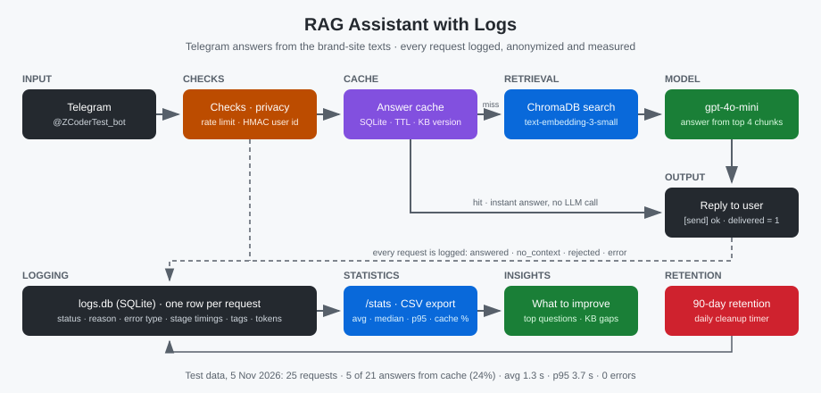

🇷🇺 [Русский](../ru/11-rag-assistant-logs.md) · 🇬🇧 [English](../en/11-rag-assistant-logs.md) · 🇪🇸 [Español](../es/11-rag-assistant-logs.md)

# Case Study: RAG Assistant with Logs

**Showcase:** [rag-assistant-logs](https://github.com/alexanderomobile/rag-assistant-logs/blob/main/README.md)
**Status:** ✅ Production

---

## Задача

Telegram-помощник по услугам с журналом каждого запроса и статистикой.

## Функционал

Бот @ZCoderTest_bot («Помощник Александра») отвечает на вопросы об услугах Александра по текстам его сайта (RAG: ChromaDB, эмбеддинги OpenAI text-embedding-3-small, gpt-4o-mini), кеш ответов в SQLite. Каждый запрос пишется в SQLite: статус, причина, тип ошибки, время по этапам, теги. Код собеседника обезличен (HMAC), контакты вырезаются из текста, хранение 90 дней по таймеру, /stats. Работает службой systemd на домашнем сервере Proxmox.

## Польза для бизнеса

Показывает, что спрашивают потенциальные клиенты, чего не хватает в материалах и как быстро идёт ответ; повторные вопросы — мгновенно из кеша. Тестовые данные 5 ноября 2026: медиана ответа 1,2 с, 7 из 26 ответов из кеша, 0 ошибок.

## Результаты

Тестовые данные 5 ноября 2026 (живых клиентов пока нет): 31 запрос — 21 демонстрационный и 10 в Telegram; 26 ответов по базе, из них 7 из кеша (27 %); медиана ответа 1,2 с, среднее 1,4 с; 4 вопроса без ответа в базе (2 не по теме, 1 услуга не описана, 1 просьба перезвонить) попали в список «что дописать»; 1 вопрос отклонён как слишком длинный; 0 ошибок. Логи показали зависание подключения к API на 60,8 с (исправлено таймаутом подключения 5 с с повтором — повторное зависание заняло 10,5 с) и ответ не из того кейса (кейсы в базе знаний переразложены).

## Стек

See showcase README.

## Функциональные блоки

RAG · Кеш ответов · Журнал запросов · Статистика · Обезличивание · Хранение 90 дней

## Скриншоты

## Запуск

See showcase README for run instructions.

---

[← К портфолио](https://github.com/alexanderomobile/portfolio/blob/main/README.md)
