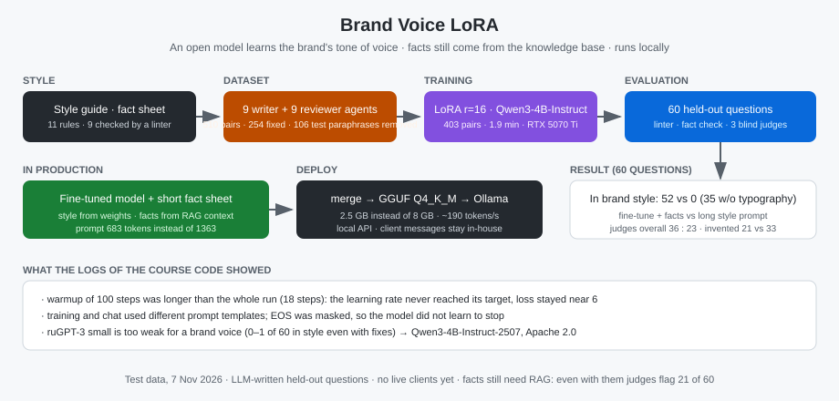

🇷🇺 [Русский](../ru/12-brand-voice-lora.md) · 🇬🇧 [English](../en/12-brand-voice-lora.md) · 🇪🇸 [Español](../es/12-brand-voice-lora.md)

# Case Study: Brand Voice LoRA

**Showcase:** [brand-voice-lora](https://github.com/alexanderomobile/brand-voice-lora/blob/main/README.md)
**Status:** 🧪 Работает на своём сервере, живых клиентов пока нет

---

## Задача

Открытая модель отвечает в tone of voice бренда: LoRA-дообучение и локальный запуск.

## Функционал

Qwen3-4B-Instruct-2507 дообучена через LoRA отвечать в стиле помощника Александра (агентства недвижимости): коротко, на «вы», без рекламы и разметки, со следующим шагом. Датасет из 403 пар написали и проверили агенты Claude по гайду стиля и фактам; пересказы контрольных вопросов найдены эмбеддингами и убраны. Оценка на 60 отложенных вопросах: линтер стиля, автопроверка чисел и контактов, слепые LLM-судьи. Модель переведена в GGUF Q4_K_M и работает в Ollama на своём сервере.

## Польза для бизнеса

Стиль бренда держит сама модель, а не длинный промпт: запрос вдвое короче, переписка с клиентами не уходит в облако. Тестовые данные 7 ноября 2026: в стиле 52 из 60 ответов против 0 у модели с длинным промптом; факты по-прежнему даёт база знаний.

## Результаты

Тестовые данные 7 ноября 2026 (живых клиентов пока нет), 60 отложенных вопросов, найденные пересказы убраны из обучения. Дообученная модель со справкой с фактами пишет в стиле бренда в 52 ответах из 60 (варианты той же модели — от 47 до 56), длинный промпт с теми же фактами — в 0 (35 без учёта типографики); запрос 683 токена вместо 1363. Слепые судьи (3 агента Claude на пару, у каждого свой порядок ответов): стиль 59 : 1 и в целом 36 : 23 в пользу дообучения, по пользе наравне (25 : 28). Выдумку по смыслу судьи нашли и со справкой — в 21 ответе из 60 (у промпта 33); без справки модель выдумывает про бренд, поэтому факты должна давать база знаний (RAG). Обучение 1,9 мин на RTX 5070 Ti; в Ollama Q4_K_M модель весит 2,5 ГБ и отвечает около 190 токенов в секунду. Независимая проверка нашла в первой версии утечку контрольных вопросов в обучение — она убрана, модель переобучена.

## Стек

See showcase README.

## Функциональные блоки

Гайд стиля · Датасет агентами · Поиск утечки · LoRA · Слепые судьи · Ollama

## Скриншоты

## Запуск

See showcase README for run instructions.

---

[← К портфолио](https://github.com/alexanderomobile/portfolio/blob/main/README.md)
