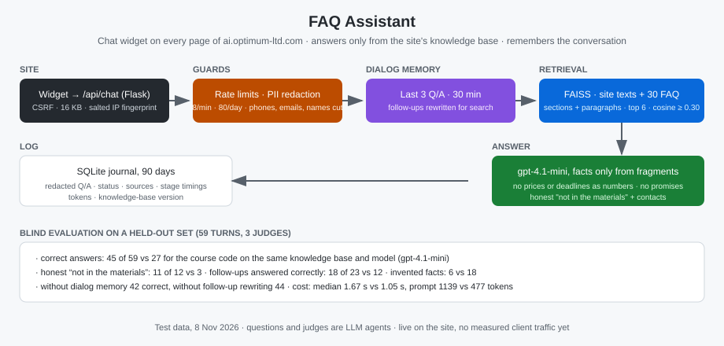

🇷🇺 [Русский](../ru/13-faq-assistant.md) · 🇬🇧 [English](../en/13-faq-assistant.md) · 🇪🇸 [Español](../es/13-faq-assistant.md)

# Case Study: FAQ Assistant

**Showcase:** [faq-assistant](https://github.com/alexanderomobile/faq-assistant/blob/main/README.md)
**Status:** 🧪 Работает на ai.optimum-ltd.com, оценка на тестовых вопросах

---

## Задача

Чат-помощник на сайте: отвечает по базе знаний, помнит разговор и понимает уточнения.

## Функционал

Виджет в правом нижнем углу каждой страницы ai.optimum-ltd.com ходит в /api/chat самого сайта (Flask, CSRF, лимит размера), сайт пересылает вопрос помощнику на FastAPI, который слушает только 127.0.0.1. Поиск FAISS по текстам сайта и 30 частым вопросам: разделы и их абзацы, text-embedding-3-large, 6 фрагментов, порог близости. Память трёх последних пар «вопрос — ответ», уточнение вроде «а второй?» перед поиском переписывается в полный вопрос. Ответ gpt-4.1-mini только по найденным фрагментам, без цен и обещаний. Контакты посетителя вырезаются до OpenAI, обезличенный журнал в SQLite на 90 дней, лимиты сообщений. Основа — учебный код pcef9, в котором памяти диалога не было.

## Польза для бизнеса

Посетитель получает ответ про услуги, кейсы и порядок работы прямо на сайте, в том числе на короткие уточнения, без выдуманных цен и обещаний; если ответа в материалах нет, помощник так и говорит и даёт контакты. Тестовые данные 8 ноября 2026: 45 верных ответов из 59 против 27 у учебного кода, выдумка в 6 ответах против 18.

## Результаты

Тестовые данные 8 ноября 2026 (живых посетителей у чата пока почти нет). Отложенный набор B — 59 реплик: 24 вопроса и 12 диалогов с уточнениями, написан агентом Claude по текстам сайта после доработки и прогонялся один раз; оценивали 3 слепых судьи-агента, у каждого свой порядок ответов. Помощник отвечает верно на 45 из 59, учебный код на той же базе знаний и той же модели — на 27; честно говорит, что ответа в материалах нет, в 11 случаях из 12 (учебный код — в 3); на уточнения верно отвечает в 18 из 23 (12); выдумка в 6 ответах (18). Без памяти диалога — 42 верных, без переписывания уточнений — 44. Цена: медиана ответа 1,67 с вместо 1,05 с, промпт 1139 токенов вместо 477. На наборе A, по которому шла доработка, первая версия давала 52 из 60, вторая — 57.

## Стек

See showcase README.

## Функциональные блоки

RAG · Память диалога · Переписывание уточнений · Обезличивание · Журнал · Виджет на сайте

## Скриншоты

## Запуск

See showcase README for run instructions.

---

[← К портфолио](https://github.com/alexanderomobile/portfolio/blob/main/README.md)
