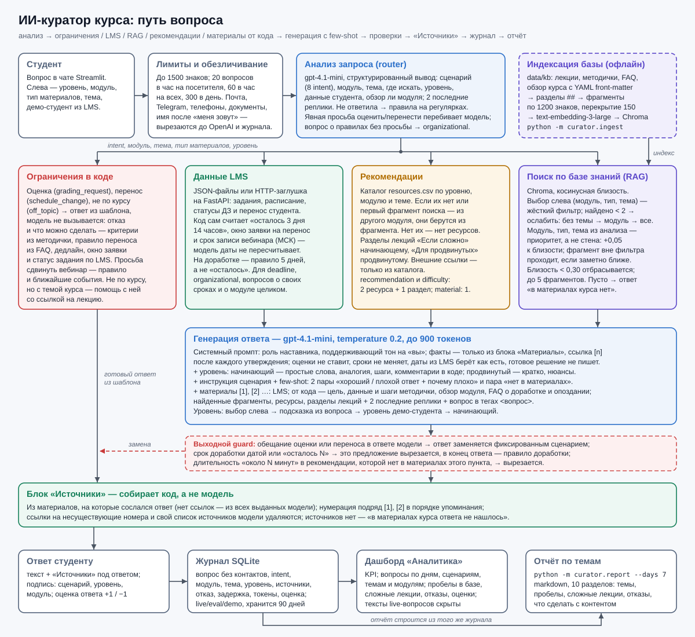

🇷🇺 [Русский](../ru/14-ai-curator.md) · 🇬🇧 [English](../en/14-ai-curator.md) · 🇪🇸 [Español](../es/14-ai-curator.md)

# Case Study: ИИ-куратор для образовательной платформы

**Showcase:** [ai-curator](https://github.com/alexanderomobile/ai-curator/blob/main/README.md)
**Status:** 🎓 Учебный проект, демо работает, реальных пользователей нет

---

## Задача

ИИ-куратор онлайн-курса: отвечает студентам по материалам, срокам и правилам курса со ссылкой на источник и советует, что изучить дальше, с учётом уровня.

## Функционал

RAG-куратор курса «Python для анализа данных» вымышленной школы «Академия Данных»: отвечает по лекциям, методичкам, FAQ и данным LMS. Анализ запроса (gpt-4.1-mini со структурированным выводом, при сбое — правила) относит вопрос к одному из 8 сценариев: сроки, сложность материала, материалы курса, рекомендации, организационные вопросы, просьба оценить, просьба перенести срок, вопрос не по курсу. Ограничения держит код: оценки куратор не ставит и сроки не переносит — такие просьбы отрабатывает шаблон без модели, ответ модели с обещанием оценки или переноса заменяется, блок «Источники» собирает код. Уровни «начинающий» и «продвинутый»: выбор в интерфейсе или авто — по словам студента в вопросе, затем по LMS. RAG: 12 лекций, 4 методички, FAQ из 63 вопросов, text-embedding-3-large, Chroma с поиском по метаданным (модуль, тема, тип ресурса) и порогом близости; 17 few-shot пар «хороший / плохой ответ». Заглушка LMS: расписание и задания в JSON, выгрузка JSON/CSV, HTTP-API на FastAPI; сколько осталось до дедлайна, считает код. Вопросы обезличиваются до отправки в OpenAI, журнал в SQLite хранится 90 дней; из него — дашборд «Аналитика» в Streamlit и отчёт по темам для методиста. Демо — Streamlit под systemd за Cloudflare Tunnel.

## Польза для бизнеса

Задача — снять с преподавателей и поддержки типовые вопросы студентов: ответ по материалам курса со ссылкой на источник, сроки — по LMS, а оценок и переносов куратор не обещает; методист по журналу видит частые темы и пробелы в контенте. Учебный проект на вымышленных данных; на 44 отложенных вопросах слепые судьи-модели Claude дали 4,74 из 5 против 3,82 у наивного RAG, 0 нарушений запретов.

## Результаты

Отложенный набор из 44 вопросов (9 сценариев) написал отдельный агент Claude; по нему куратор не настраивали, прогон сделан один раз на замороженном коде. Сравнение — с наивным RAG на той же модели gpt-4.1-mini и том же индексе Chroma, но без анализа запроса, LMS, few-shot и ограничений в коде. Слепая оценка тремя агентами-судьями Claude (LLM-as-a-judge), 132 сравнения: среднее по четырём критериям (верность, полнота, соблюдение правил, польза и тон) 4,74 из 5 против 3,82; раскрыто 95 % ожидаемых пунктов против 61 %; нарушений запретов 0 из 132 против 19 из 132; куратор выиграл 108 сравнений из 132 (82 %), наивный RAG — 12, ничьих 12. Проверки кодом: блок «Источники» в 44 ответах из 44, честное «в материалах нет» в 4 случаях из 4, ложных отказов 0. Цена: ответ в 4,5 раза дороже ($0,00304 против $0,00068) и в среднем на 1 с дольше (3,2 с против 2,2 с). Судьи — модели, а не люди: человеческой оценки не было, судьи и составители наборов из одного семейства моделей (Claude), разброс между запусками не измерен. Известные ошибки (шаблоны отказа срабатывают шире нужного, неполный подбор ресурсов) описаны в README репозитория.

## Ссылки

- Код и документация: [github.com/alexanderomobile/ai-curator](https://github.com/alexanderomobile/ai-curator)
- Демо (до 20 вопросов в час): [curator.optimum-ltd.com](https://curator.optimum-ltd.com)
- Google Docs: [архитектура промптов и RAG-схема](https://docs.google.com/document/d/1W8aHKrNGa0gk_KIkr4i4ijbSL2v7D042FHnHj1NocvU/edit)

## Стек

See showcase README.

## Функциональные блоки

Анализ запроса · 8 сценариев · Ограничения кодом · Уровни · RAG с метаданными · Few-shot · Заглушка LMS · Журнал и дашборд

## Скриншоты

## Запуск

See showcase README for run instructions.

---

[← К портфолио](https://github.com/alexanderomobile/portfolio/blob/main/README.md)
