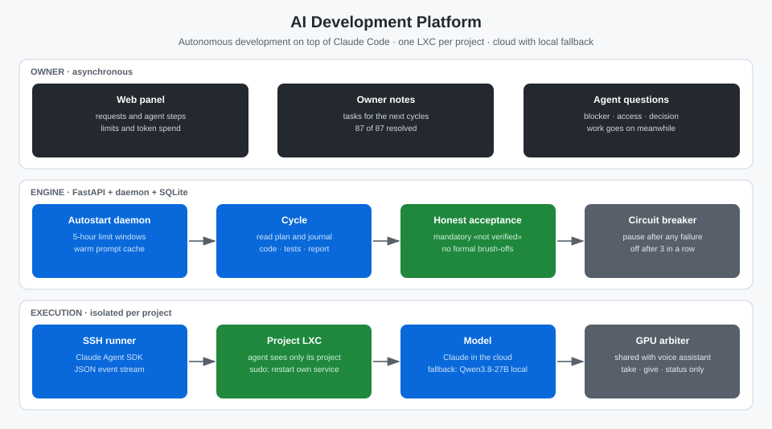

🇷🇺 [Русский](../ru/15-ai-dev-platform.md) · 🇬🇧 [English](../en/15-ai-dev-platform.md) · 🇪🇸 [Español](../es/15-ai-dev-platform.md)

# Case Study: AI Development Platform

**Status:** ✅ Внутренний инструмент в работе · свой сервер · исходный код закрыт

---

## Задача

Над несколькими проектами работает один человек, а Claude Code умеет писать и проверять код сам. Но в обычном терминале агент ждёт, пока его позовут: задача поставлена — сессия закончилась — следующая начнётся, когда владелец вернётся к компьютеру. Лимит подписки при этом обнуляется каждые пять часов, и всё, что не потрачено в окне, сгорает.

Нужна была платформа, которая ведёт разработку сама: берёт задачи из плана проекта и из замечаний владельца, работает окнами лимита, проверяет результат тестами, честно пишет, что не проверено, и задаёт вопросы асинхронно, не останавливая работу. И всё это так, чтобы агент с полными правами не мог задеть соседние проекты и сам сервер.

## Функционал

**Веб-панель.** Лента запросов и шагов агента, замечания владельца, вопросы агента, лимиты и расход токенов по каждому проекту.

**Автозапуск.** Фоновый демон работает сериями циклов в каждом пятичасовом окне лимита: агент читает память проекта (план и журнал), берёт задачу, пишет код, прогоняет тесты, записывает итог и сам сообщает, когда задач больше нет.

**Оркестратор.** Второй режим для больших задач: архитектор строит план, агенты по ролям выполняют шаги, ревьюер принимает результат.

**Асинхронный диалог.** Вопрос агента оформляется как блокер, доступ или решение и ждёт ответа в панели; работа над остальным продолжается.

**Локальная модель на случай отказа облака.** Режим «облако, пока отвечает, иначе своя модель»: Qwen3.8-27B на собственной видеокарте, 48–54 токена в секунду.

## Польза для бизнеса

Разработка идёт, пока владелец занят другим: подписка выбирается целиком, задачи закрываются ночью, а владельцу остаются решения и ответы на вопросы. На платформе ведутся два боевых проекта — AutoFunnel и MuzloProm.

## Стек

Python · FastAPI · Claude Agent SDK · Claude Code · SQLite (WAL, FTS5) · ванильный JS · Proxmox VE (LXC на проект) · systemd · SSH · Ollama · Qwen3.8-27B

## Инженерные решения

**Агент с полными правами заперт в своём контейнере.** Автозапуск работает без запросов разрешений, иначе ночью он встанет на первом же вопросе. Поэтому каждый проект живёт в отдельном LXC: агент не видит другие проекты и хост, через sudo может только перезапустить собственный сервис, а наружу отдаёт только поток событий в JSON.

**Ритм по окнам лимита.** Демон считает пятичасовые окна по телеметрии лимитов из SDK: серия циклов, пока кэш промпта тёплый, затем ожидание сброса. Изменчивые части промпта вынесены в конец, чтобы кэш не сбрасывался на каждом цикле.

**Защита от раскрутки после реального инцидента.** Когда сеть начала отвечать ошибкой 403, демон без паузы прокрутил 1304 цикла за 2,3 часа. После разбора: пауза после любого сбоя, проект выключается после трёх сбоев подряд, перед стартом проверяется лимит.

**Честная приёмка.** Отчёт агента обязан содержать блок «не проверено», и формальная отписка в нём не принимается. Так владелец видит, где нужен его взгляд, а не читает «всё готово».

**Одна видеокарта на два проекта.** Локальная модель платформы и голосовой ассистент делят одну карту через арбитр: платформа берёт её узкой SSH-командой, которой разрешены только «взять», «отдать» и «статус», и возвращает после 10 минут простоя.

**Режим выбран по цифрам.** Замер показал, что на мелких задачах оркестратор с ролями в 5–7 раз дороже одного агента. Поэтому основная работа идёт в автозапуске, а оркестратор оставлен для крупных задач.

## Метрики

| показатель | значение |
|---|---|
| Коммитов платформы | **87** (06.07–03.11.2026) |
| Кода платформы | около 9,4 тыс. строк |
| Первый месяц: запросов к агентам | 124, из них 101 в автозапуске |
| Циклы автозапуска первого месяца | 78 завершены · 16 на паузе по лимиту · 7 со сбоем |
| Средняя длительность цикла | около 20 минут |
| Замечаний владельца разобрано к 28.08.2026 | **87 из 87** |
| Боевых проектов на платформе | 2 (AutoFunnel, MuzloProm) |
| Локальная модель при отказе облака | 48–54 токена/с |

Расход первого месяца по счётчику SDK — около 778 $ в пересчёте на тарифы API. Работа шла по подписке, фактически эти деньги не платились.

## Роль

Владелец и архитектор: постановка задач, ключевые решения (автономность, изоляция, приоритет качества над экономией), сборка сервера. Код платформы написан в сессиях Claude Code под моим руководством.

## Скриншоты

## Запуск

Платформа развёрнута на собственном узле Proxmox. Адреса, реквизиты и исходный код не публикуются.

---

[← К портфолио](https://github.com/alexanderomobile/portfolio/blob/main/README.md)
