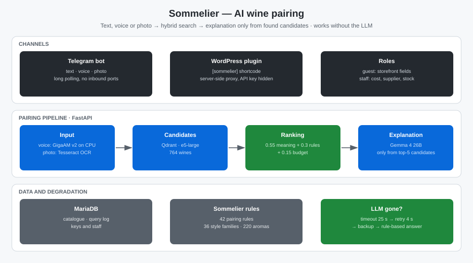

🇷🇺 [Русский](../ru/16-sommelier.md) · 🇬🇧 [English](../en/16-sommelier.md) · 🇪🇸 [Español](../es/16-sommelier.md)

# Case Study: Sommelier — ИИ-подбор вина

**Status:** 🧪 Пилот: развёрнут 27.08.2026 на своём сервере, внедрение у заказчика не завершено · исходный код закрыт

---

## Задача

Заказчик — винная компания с сайтом на WordPress. Сценариев два. Гость спрашивает «что взять к утке до 5000» и хочет внятный совет, а не фильтр из двадцати галочек. В ресторане закончилась позиция, и сотруднику за минуту нужна замена: похожий профиль, цена в пределах ±30%, в наличии. При этом сотрудник должен видеть закупочную цену и поставщика, а гость — никогда.

Отдельное условие: языковая модель стоит на общей видеокарте, которую делят несколько проектов, и может пропасть в любой момент. Подбор при этом должен продолжать работать.

## Функционал

**Подбор текстом, голосом и по фото.** Запрос пишут, наговаривают или фотографируют этикетку либо винную карту. Голос распознаётся на процессоре, фото читается OCR, дальше всё идёт одним путём подбора.

**Замена позиции.** Похожее вино по стилевому семейству, цена ±30%, сладость держится в своей семье, чтобы сухое не заменили полусладким.

**Объяснение выбора.** Модель коротко объясняет, почему подходит именно это вино, но выбирает только из пяти кандидатов, которых нашёл поиск.

**Два канала.** Телеграм-бот и плагин WordPress с шорткодом: текст, голос и фото прямо на странице сайта.

**Роли.** Гость видит витринные поля, сотрудник — закупочную цену, поставщика и остаток.

## Польза для бизнеса

Гость получает совет уровня сомелье на сайте и в мессенджере, ресторан находит замену закончившейся позиции за один запрос, а закупочные цены не утекают в браузер.

## Стек

Python 3.12 · FastAPI · aiogram 3 · MariaDB · Qdrant · multilingual-e5-large · Gemma 4 26B (своя видеокарта) · GigaAM v2 (речь, ONNX на CPU) · Tesseract · WordPress-плагин (PHP, JS) · Proxmox LXC · systemd · Cloudflare Tunnel

## Инженерные решения

**Модель не может выдумать вино.** Она получает только топ-5 кандидатов из каталога и объясняет выбор среди них. Это закрыто интеграционным тестом с заведомо отсутствующим вином.

**Подбор работает и без модели.** Цепочка при отказе: таймаут 25 с → повтор через 4 с → запасной адрес модели → разбор запроса правилами и честный ответ шаблоном.

**Фото без модели зрения.** Свободной видеопамяти нет, а этикетка и винная карта — это текст. Поэтому вместо модели зрения стоит OCR, и распознанный текст идёт общим путём подбора.

**Гибридное ранжирование.** Итоговый балл: 0,55 смысловой близости + 0,3 правил сомелье + 0,15 попадания в бюджет. Категория блюда задаёт требования к телу, кислотности и танинам. Если кандидатов мало, фильтры ослабляются по одному.

**Закупочные цены защищены в одной точке.** Поля срезаются по роли в одной функции, это закрыто тестом. Плагин держит ключ API на сервере сайта, ограничивает частоту по IP и отдаёт наружу только витринные поля.

**Каталог собран исследованием.** Три прохода агентов (38 агентов, каждый результат проверен критиком) собрали методику и каталог: 764 вина из 294 виноделен 28 стран, у каждого строгий профиль. Дублей и брака при слиянии — 0.

## Метрики

| показатель | значение |
|---|---|
| Вин в каталоге · виноделен · стран | **764** · 294 · 28 |
| Машинных правил сомелье | 42 правила сочетаемости · 36 стилевых семейств · 220 ароматов |
| Нагрузочная проверка через публичный адрес | **24 из 24** запросов при 6 параллельно, в среднем 11,9 с |
| Тесты | 15 модульных и 2 интеграционных, проверка типов — 0 ошибок |

Нагрузочная проверка синтетическая: живого трафика пилот ещё не получал. Узкое место — общая языковая модель, два вызова на запрос.

## Роль

Владелец проекта и постановщик: требования, решения по архитектуре и деградации, развёртывание на своём сервере. Код написан в сессиях Claude Code под моим руководством.

## Скриншоты

## Запуск

Развёрнут на собственном узле Proxmox, наружу только через туннель. Адреса, ключи и данные заказчика не публикуются.

---

[← К портфолио](https://github.com/alexanderomobile/portfolio/blob/main/README.md)
