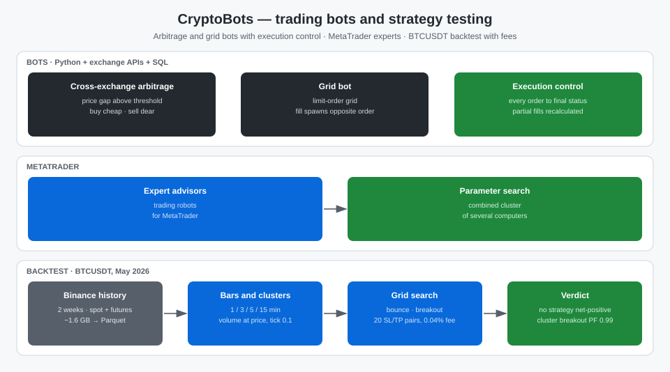

🇷🇺 [Русский](../ru/17-crypto-trading-bots.md) · 🇬🇧 [English](../en/17-crypto-trading-bots.md) · 🇪🇸 [Español](../es/17-crypto-trading-bots.md)

# Case Study: CryptoBots — торговые боты и проверка стратегий

**Status:** Боты — ранние проекты, исходный код недоступен, описание автора · бэктест 2026 года — с цифрами

---

## Задача

Торговый бот теряет деньги не столько на плохой идее, сколько на исполнении: ордер исполнился частично, биржа ответила с задержкой, соединение оборвалось между двумя ногами сделки. И на второй причине: стратегию запускают раньше, чем проверили её на истории с комиссиями.

## Функционал

**Межбиржевой арбитраж.** Бот следит за ценой одного актива на нескольких биржах и при расхождении выше порога покупает там, где дешевле, и продаёт там, где дороже.

**Сеточный бот.** Сетка лимитных ордеров вокруг цены: каждая исполненная покупка порождает продажу уровнем выше, и наоборот.

**Контроль исполнения ордеров.** Каждый ордер отслеживается до конечного статуса, включая частичное исполнение. Остаток ордера и встречная нога пересчитываются по фактически исполненному объёму, а не по заявленному. Состояние ордеров хранится в SQL-базе.

**Советники для MetaTrader.** Торговые роботы для терминала MetaTrader. Подбор их параметров шёл на объединённом кластере из нескольких компьютеров, чтобы перебор занимал часы, а не дни.

**Бэктест скальпинга (2026).** Отдельный проект проверки стратегий на истории BTCUSDT — описан ниже с цифрами.

## Польза для бизнеса

Бот торгует круглосуточно и не нервничает, но главное — он не оставляет «висящих» остатков после частичного исполнения ордера. А бэктест с комиссиями отсекает стратегию до того, как на ней потеряют реальные деньги.

## Стек

Python · REST API бирж · SQL · MetaTrader · кластер подбора параметров · pandas · NumPy · Parquet · MySQL

## Бэктест скальпинга BTCUSDT (май 2026)

**Данные.** История сделок BTCUSDT с публичного архива Binance за две недели: спот и фьючерсы USDT-M, около 1,6 ГБ сырых CSV, переложены в Parquet.

**Признаки.** Минутные свечи и кластерные профили (объём по цене с шагом 0,1) на таймфреймах 1, 3, 5 и 15 минут.

**Стратегии.** Отскок от уровня и пробой уровня, в лонг и в шорт. Для каждой — сетка из 20 сочетаний стоп-лосса и тейк-профита, комиссия тейкера 0,04% на сторону, удержание не дольше двух часов, пауза после сделки.

**Хранение.** Прогоны, сделки и кривые доходности пишутся в MySQL и выгружаются для графиков. Заодно по той же истории рассчитаны рекомендованные параметры для скальперского терминала.

**Результат — честный.** После комиссий ни одна стратегия не вышла в плюс. Кластерный анализ заметно улучшил пробой на фьючерсах: профит-фактор вырос с 0,45 на обычных свечах до 0,99 на кластерах, а убыток за период сократился с −4,1% до −0,05%. Этого всё равно мало для реальных денег, поэтому стратегия в торговлю не пошла. Бэктест сделал свою работу: сэкономил депозит.

## Метрики

| показатель | значение |
|---|---|
| Типы ботов | арбитраж · сетка · советники MetaTrader |
| Контроль исполнения | до конечного статуса, включая частичное |
| Бэктест: история | 2 недели BTCUSDT, спот и фьючерсы, ~1,6 ГБ |
| Бэктест: сочетаний SL/TP на стратегию | 20 |
| Пробой на кластерах vs на свечах | профит-фактор **0,99** против 0,45 |

## Скриншоты

## Запуск

Исходный код ботов недоступен и не публикуется. Бэктест — личный исследовательский проект.

---

[← К портфолио](https://github.com/alexanderomobile/portfolio/blob/main/README.md)
